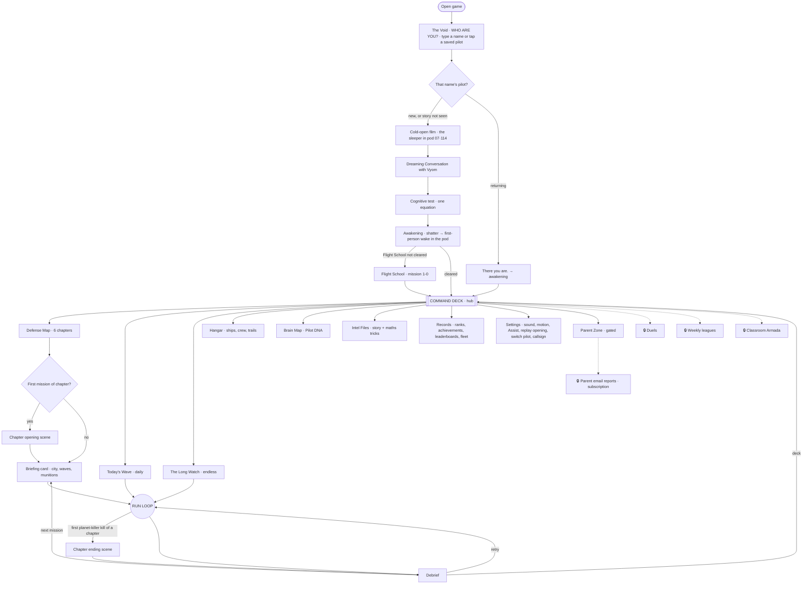
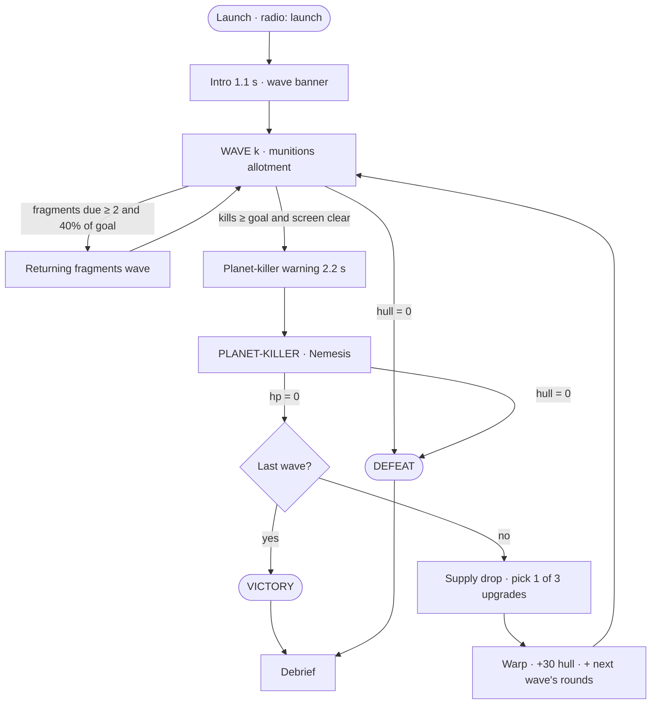
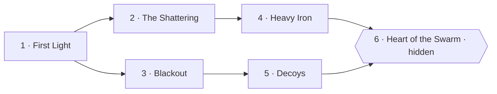
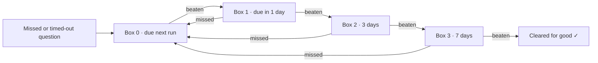

# Space Math — Master Flowmap

This is the single source of truth for how the game fits together. Every number in this document is implemented in code (file references are in brackets). Items marked **🔒 PLANNED** need a backend (accounts, payments or real-time networking) and are not built yet.

**Naming:** the player sees story names (Defense Map, wave, planet-killer, supply drop…). The code still uses the original identifiers (`systems`, `sector`, `boss`, `perks`, `saucer`, `revenant`…) so saves and leaderboards stay compatible. The table in §0 maps one to the other; keep both when you add things.

---

## 0. Story: "The Swarm" (Earth, 2047) [`data/story.js`, `ui/story.js`, `ui/dream.js`, `ui/cinema.js`]

Year 2047. A meteor swarm detected by the lunar far-side observatories falls on Earth in waves over months. Automated defenses can't cope, so the world relies on the **Interceptors**. The war outlasts the supplies: every round is precious, and a wrong answer wastes a city's worth of ammunition.

| Game system | Story name |
|---|---|
| Galaxy map, 6 systems | **Defense Map**, 6 chapters: First Light · The Shattering · Blackout · Heavy Iron · Decoys · Heart of the Swarm |
| Sector | Wave |
| Mothership / Dreadnought | **Planet-killer** (Titan-1, The Splinter, The Ghost Rock, Atlas Mass, The Twin, The Heart of the Swarm) |
| rock / saucer / splitter / swarm | Stony / iron / fracturing meteor / debris cluster |
| cloaked / beacon / shield / mirror | Dark meteor / tracking ping / ice-crusted meteor / twin track |
| ally / revenant | Supply shuttle (never fire) / returning fragment |
| Perk draft | Supply drop |
| Codex | Intel files (story fragment + maths trick) |
| Deep Space / Daily Galaxy | The Long Watch / Today's Wave |

**Cast:** Vyom (architect of the Interceptor program; the opening, the HUD icon and supply-drop lines), Commander Aisha Rao (Interceptor Command, briefings), Dr. Kenji Mori (Far Side Observatory, intel), Lina "Spark" Okoye (rookie gunner, your wing).

**Story beats** (stored in `profile.seen`):

- **Opening: "The Dreaming Mind"** [`ui/dream.js`, `ui/cinema.js`, `ui/cinema-art.js`, `css/dream.css`, `DREAM` / `DREAM_TEST` in `data/story.js`]. **Every visit starts here**, and the name typed in the Void picks the pilot. New pilots (and pilots who haven't seen it) get the whole opening; returning pilots hear *"There you are."* and wake straight onto the Command Deck (or into Flight School if it isn't cleared yet). Replay the full opening from Settings or Intel Files.
  1. **The Void:** black, a single spark, then a neural web (violet / amber / rose-gold) grows and asks **WHO ARE YOU?** Each typed letter sends a ripple and a chime through the web; saved pilots are offered as tap-to-wake names. On Enter the web contracts around the name and whispers *"There you are."* The name is saved here and becomes the callsign.
  2. **The cold open (a short film, about 35 s)** [`ui/cinema.js`]. Letterbox bars, captions in the bars, **SKIP →** after 3 s (`Esc`).
     - Title card: EARTH · 2047 / INTERCEPTOR CRYO VAULT · LUNAR GATEWAY.
     - Wide shot: a perspective dolly into a vault of pods (real 3D projection), a light beam with dust, a crimson beacon sweeping.
     - Side dolly along **pod 07·114**, feet → head: the sleeper (cryo suit, thermal blanket, pillow, hand on the blanket) under frosted glass. The name plate reads *PILOT: <name>*, and the heart monitor shows 7 BPM.
     - Insert: the pod screen types WAKE SEQUENCE · authorised by: Vyom, with a soft alarm.
     - Close-up of the face: heating coils glow, frost melts outward from the face, meltwater runs down, the heartbeat rises (12 → 46 BPM), and the first breath fogs the glass.
     - Extreme close-up of the eye: frost melting on the lashes, the eye moving under the lid (REM). The camera pushes into the eye, into the dream.
  3. **The Dreaming Conversation:** 14 lines between the player (silver, left or top) and **Vyom** (amber, right or bottom, a rotating icosahedron of light). Four phases (fragmentation → recognition → the stakes → the bridge) change the dreamspace: links form, maths symbols drift and then orbit Earth, memory shards float past, and the 21 cities light up. Each line forms letter by letter (1.5–3 s), holds 2 s, then advances; a tap or `Enter` skips ahead. **SKIP →** (`Esc`) appears after 3 s and jumps straight to the awakening.
  4. **The cognitive test:** a real Flight School equation (`add`/`sub`, level 1) on the game's own numpad (moved into the dream, translucent, FIRE shows ✓). A wrong answer gets a gentle retry line with no penalty.
  5. **The awakening:** the web ignites, light cracks it open, and the dream shatters outward (a snapshot of the last frame, drawn on the canvas). Then, in first person inside the pod (about 7 s): light glows red through the closed eyelids, the eyes flutter and blink twice, the blurred ceiling lights come into focus, the canopy hisses open in a burst of steam, and the captions read *STASIS ENDED · 7 YEARS, 142 DAYS* and *INTERCEPTOR <NAME> · REPORT TO LAUNCH*.
  6. **Into the game:** a white flash, then the HUD lands piece by piece (score, hull, wave, callsign, Vyom's icon). New pilots go straight into Flight School with no briefing card.
  - **How it's drawn:** everything is canvas and code; there are no image or audio files. The sleeper is one vector illustration (`cinema-art.js`) rasterised once per film, whole and as face and eye crops; frost, the hand, the monitor, breath, drips and lights are drawn live. Reduced motion skips the shatter, the letter scatter and the focus blur.
- **Pilots on one device** [`services/profile.js`]: each name has its own save (`sm_pilot_<name>`, any letter case), listed in the roster `sm_pilots_v1`. The Void shows up to 6 saved pilots. Settings › **Switch pilot** goes back to the Void; renaming refuses a name another pilot uses; the Parent Zone reset erases only the current pilot. The old single save (`sm_profile_v2`) migrates into the roster automatically, and a new pilot inherits the device's sound and motion settings.
- **Vyom stays:** the HUD shows `INTERCEPTOR: <name>` with Vyom's amber icon. At every supply drop he sends one line (`VYOM_LINES`, 18 lines, `pickVyomLine`). Priority: heavy hull damage (≥30% lost or hull ≤30%) > a line for that exact wave not heard yet (waves 1, 3, 5) > a perfect wave (no misses, no hull lost) > the wave stage (early ≤2, mid ≤7, late). The last 12 lines heard are kept in `profile.seen.vyomHeard`, so returning players hear new ones first.
- Chapter opening before the first mission of each chapter; chapter ending after its planet-killer first falls (6-1 plays the finale). Replay from the Defense Map.
- Mission briefing card before every story launch: defended city, waves, munitions, threats. Retry from the debrief skips it.
- In-run radio chatter for key moments (`RADIO` events: launch, cluster, fracture, shuttle, ammoLow, dry, wasted, boss, bossHalf, hullCrit, streak, waveClear, returning, impact).
- Each mission defends a city (`CITIES`); the deck shows **Day N of the Swarm** and **Earth status** (cities protected).

### Munitions [`config.js`, `game.js › _spend / _allotment`]

| Rule | Value |
|---|---|
| Rounds per wave | ⌈(wave kills + planet-killer HP) × 1.5⌉ + 4 (+8 with Munitions Factory) |
| Correct answer | −1 round (a debris cluster costs 1 for all three) |
| BLAZING answer | round recovered (+1) |
| Wrong answer / friendly fire | −1 round wasted (not with Recycler) |
| Echo, Chain Lightning, Carrier drone | free |
| Empty magazine | answer is held; emergency feed gives 1 round every 2.5 s, so a run can't soft-lock |
| Supply drop between waves | + next wave's allotment, leftovers carry over (cap 99) |
| Off | Flight School, Assist mode |
| ★★★ | 85% accuracy + zero impacts + magazine never ran dry |

Debrief shows rounds fired, munitions efficiency (non-wasted ÷ fired), rounds wasted/recovered.

---

## 1. Player journey (top level)

The opening takes `Enter`/`Space`/`→` or a tap for the next line and `Esc` to skip (the conversation and each film). The story player [`ui/story.js`] takes `Enter`/`Space`/`→` for next (finishes the typewriter first) and `Esc` to skip. On a briefing, `Esc` jumps to the briefing card, and `Esc` again goes back to the deck.

---

## 2. The run loop (every mission, Today's Wave and The Long Watch)

### Answer resolution (every keystroke) [`game.js › _evaluate`]

| Input state | Result |
|---|---|
| Magazine empty | Nothing fires; the answer is held until the emergency round arrives (§0 Munitions) |
| Equals a hostile answer and is not a prefix of another live answer | Fire instantly (−1 round) |
| Equals a hostile answer **and** is a prefix of another (e.g. `5` vs `56`) | Wait 450 ms for more digits, then fire |
| Equals a **supply shuttle** answer | Friendly fire: −12 hull, streak reset, 1 round wasted |
| Not a prefix of any live answer and at least as long as the target's answer | Miss: −8 hull, streak reset, 1 round wasted |
| `Enter` | Force resolution |
| Choice threats (twin tracks) | A single key, `1` or `2` |

### Damage and repair [`config.js`]

| Event | Hull |
|---|---|
| Impact (meteor reaches the defense line) | −34 |
| Planet-killer impact | −45 (then knocked back) |
| Miss | −8 |
| Friendly fire | −12 |
| Streak repair (every 10) | +15 |
| Wave held | +30 |

The Earth's city lights under the ship dim as hull drops (purely visual).

### Scoring

`points = base × (1 + 0.25 × (level−1)) × multiplier × (1.5 if BLAZING) + 25×mult if CLUTCH`
Multiplier tiers by streak: 0→×1, 5→×2, 10→×3, 20→×4, 35→×5. BLAZING ≤ 35% of the time used, CLUTCH ≥ 82%.
Special: Clean Break ×2 · Debris cluster ×2.5 · Returning fragment ×1.5 · Planet-killer hit = 60 + 0.5 × base.

### Radio chatter [`data/story.js › RADIO`, `game.js › _radio`]

Short portrait + line pop-ups (top-left, under the HUD). Most fire once per run: `launch`, `cluster`, `fracture`, `shuttle`, `wasted`, `bossHalf`, `hullCrit`, `streak` (10), `waveClear`, `returning`, `impact`. `ammoLow`, `dry` and `boss` can repeat.

---

## 3. Threat catalogue [`game.js`, `render.js`]

| Code id | Player sees | Thinking skill trained | Behaviour |
|---|---|---|---|
| `rock` | Stony meteor | Calculation | Descends; its distance is the timer. Fiery entry trail grows as it falls |
| `saucer` | Iron meteor | Calculation | As above, wobbles; glowing hot leading edge |
| `splitter` | **Fracturing meteor** | Decomposition | Shows `24 × 15`. Unsolved at 35% of the way down, it cracks into `24 × 10` and `24 × 5` (each gets 75% time). Solving it whole first = **CLEAN BREAK ×2** |
| `swarm` (3 minis) | **Debris cluster** | Equivalence | Three rocks joined by a faint tether, three expressions with **one shared answer** (`4×9`, `6×6`, `12×3`). One answer, one round, ×2.5 |
| `cloaked` | **Dark meteor** | Working memory | Problem visible for 1.4 s, then shows `? ? ?` |
| `beacon` | **Tracking ping** | Short-term memory | A probe-tagged rock flashes a 3–6 digit code for 1.2 s + 0.3 s/digit; type it (↺ = reversed) |
| `shield` | **Ice-crusted meteor** | Multi-step | Needs 2 answers: ice crust, then core |
| `mirror` | **Twin track** | Estimation / comparison / checking | Choice: `① 47×19  ② 900 — which is bigger?` or `36×4 = 154 · ① TRUE ② FALSE` |
| `ally` | **Supply shuttle** (green) | Inhibitory control | Crosses the screen. **Do not answer it.** It never impacts |
| `revenant` | **Returning fragment** | Spaced repetition | Replays a question you previously missed |
| `boss` | **Planet-killer** (Nemesis) | Weak-skill practice | Giant rock with molten cracks that spread as its HP drops. 60% of its questions come from your 3 weakest skills; in The Long Watch / Today's Wave it's named after the weakest ("Planet-killer · Percentages") |

---

## 4. Defense Map [`data/galaxy.js`, story text in `data/story.js`]

| Code id | Chapter | Zone | Story art |
|---|---|---|---|
| `arith` | 1 · First Light | High lunar orbit | moon |
| `fraction` | 2 · The Shattering | Mid orbit | swarm |
| `memory` | 3 · Blackout | Solar storm belt | storm |
| `power` | 4 · Heavy Iron | Low orbit | iron |
| `logic` | 5 · Decoys | Upper atmosphere | swarm |
| `singularity` | 6 · Heart of the Swarm | The core body | core (finale: stars) |

A chapter unlocks when the previous chapter's planet-killer is broken. Heart of the Swarm appears when all 5 planet-killers are broken **or** you reach a 50-streak in any run.

| # | Mission | Defends | Skills | Threats | Level | Waves |
|---|---|---|---|---|---|---|
| 1-0 | Flight School | Lunar Gateway | add, sub (easy) | stony | 1 | 1 (boss hp 3) |
| 1-1 | First Wave | Lagos | add, sub | stony, iron | 1 | 2 |
| 1-2 | Debris Storm | Mumbai | times tables | stony, iron, cluster | 1 | 2 |
| 1-3 | Cracking Rocks | São Paulo | tables, 2d×1d | stony, fracturing, iron | 2 | 2 |
| 1-B | **Titan-1** | Tokyo | all above + doubles | mixed + boss hp 8 | 2 | 1 |
| 2-1 | Divide & Conquer | Cairo | division, doubles/halves | stony, iron, ice-crusted | 2 | 2 |
| 2-2 | Percent Rain | Jakarta | percentages | stony, iron, cluster | 3 | 2 |
| 2-3 | Supply Lines | Mexico City | fractions | iron, ice-crusted, shuttle | 4 | 2 |
| 2-B | **The Splinter** | New York | all ch. 2 | mixed + boss hp 9 | 4 | 1 |
| 3-1 | Tracking Pings | Nairobi | codes | ping, stony | 1 | 2 |
| 3-2 | Dark Rocks | Seoul | tables, add (dark) | dark, iron | 2 | 2 |
| 3-3 | Echo Chamber | Istanbul | codes (reversed), dark | ping, dark, shuttle | 3 | 2 |
| 3-B | **The Ghost Rock** | London | all ch. 3 | mixed + boss hp 8 | 3 | 1 |
| 4-1 | Square Up | Kolkata | squares, roots | stony, iron, fracturing | 3 | 2 |
| 4-2 | Order Protocol | Buenos Aires | BODMAS, missing numbers | ice-crusted, iron, shuttle | 4 | 2 |
| 4-3 | Deep Freeze | Manila | negatives, powers | iron, cluster, dark | 5 | 2 |
| 4-B | **Atlas Mass** | Shanghai | all ch. 4 | mixed + boss hp 10 | 5 | 1 |
| 5-1 | Pattern Lock | Sydney | sequences | stony, iron | 2 | 2 |
| 5-2 | Twin Tracks | Lima | comparisons | twin track, iron | 3 | 2 |
| 5-3 | False Echoes | Toronto | true/false, rounding | twin track, shuttle, fracturing | 4 | 2 |
| 5-B | **The Twin** | Paris | all ch. 5 | mixed + boss hp 10 | 4 | 1 |
| 6-1 | **The Final Wave** (boss: The Heart of the Swarm) | Every city on Earth | everything | everything | 6 | 4 |

**Stars:** ★ clear · ★★ accuracy ≥ 85% · ★★★ accuracy ≥ 85% **and** zero impacts **and** the magazine never ran dry.
**Planet-killer rewards (first kill):** crew member + intel file + next chapter + the chapter-ending scene.

**The Long Watch** (endless; its waves cycle through the chapter themes) and **Today's Wave** unlock after Flight School.

---

## 5. Supply drop (roguelite perk draft) [`data/perks.js`]

Offered after every planet-killer that isn't the last one (missions with more than 1 wave, The Long Watch and Today's Wave). Three random upgrades are shown; press 1, 2 or 3. Upgrades stack. Above the cards, Vyom sends one line chosen by how the wave went (§0).

| Perk | Effect |
|---|---|
| Prime Hunter | Prime answers: ×2 points and +3 hull |
| Nine Lives | Multiples of 9 repair +4 hull |
| Overclock | Streak counts double; misses cost double |
| Echo Cannon | Even answers also destroy the next-most-urgent small meteor (free round) |
| Time Dilation | Meteors move 12% slower |
| Deflector | First impact each wave is absorbed |
| Nano Repair | +1 hull per correct answer |
| Chain Lightning | BLAZING answers also destroy one other meteor (free round) |
| Bounty Hunter | +40% credits from this run |
| Steady Hands | One miss per wave doesn't break your streak |
| Scanner | Dark meteors and tracking pings stay visible +0.8 s |
| Glass Cannon | ×1.5 points, max hull −30 |
| **Munitions Factory** | +8 rounds now and +8 extra in every supply drop |
| **Recycler** | Wrong answers no longer waste a round |

---

## 6. Returning fragments · spaced repetition [`services/profile.js › revenants`]

Up to 40 are stored (the oldest are dropped). Memory codes are never stored, because they are random. Up to 5 due fragments (at least 2) form a wave in wave 1 of any mission or Long Watch run once 40% of the wave goal is reached; wave 1 gets extra rounds for them. Today's Wave has no returning fragments, so it stays identical for every pilot. The deck's Earth Status tile shows how many are due.

---

## 7. Meta progression [`services/progression.js`]

| Currency | Earned |
|---|---|
| **XP** | score ÷ 25 + 3 × kills + 150 on victory |
| **Credits** | score ÷ 80 + 40 per star + 60 on victory + 150 on first clear + 150 on first Today's Wave of the day + achievement rewards; Bounty Hunter +40% |

**Ranks (XP)** [`data/ranks.js`]: Cadet 0 · Gunner 500 · Pilot 1,500 · Flight Lead 3,000 · Wing Leader 5,500 · Squadron Leader 9,000 · Commander 14,000 · Group Captain 21,000 · Air Marshal 30,000 · Defender of Earth 42,000 · then Legend I, II… every +15,000.

**Hangar** [`data/ships.js`]

| Ship | Cost | Trait |
|---|---|---|
| Interceptor | free | Balanced |
| Scout | 600 | +20% time, −15% points |
| Gunship | 1,200 | +20% points, max hull 85 |
| Carrier | 2,000 | Drone auto-destroys the easiest meteor once per wave (free round) |
| Phantom | destroy the Heart of the Swarm | Starts every run with one random upgrade |

Engine trails: Cyan (free) · Ember 250 · Toxic 250 · Royal 400 · Gold 800.

**Crew** (one on duty, earned from planet-killers; code ids in brackets): Engineer Hollis [`rao`] +10 max hull · Medic Ayo [`ayo`] repair every 8-streak · Signals Officer Mira [`mira`] pings +40% visible · Gunner Kade [`kade`] every 5th planet-killer hit deals double · Navigator Vega [`vega`] twin tracks/patterns +25% time. *(Engineer Hollis is not the story's Commander Aisha Rao; the id `rao` is kept for old saves.)*

**Achievements** (20, each pays credits) · **Intel Files** (16; each = story fragment `intel` + maths trick `body`) · **Brain Map** (mastery star for every skill) · **Pilot DNA** (archetype + strengths, shareable).

**Story meta on the deck:** "Day N of the Swarm" = 1 + 3 × missions cleared + min(total runs, 40). **Earth Status** = cities protected (cleared missions excluding 1-0) out of 20.

Mastery per skill = accuracy × speed factor × confidence, where speed factor = clamp(2.5 s ÷ average time, 0.4, 1) and confidence = n ÷ (n + 6).
Tiers: Dim < 0.30 · Glowing < 0.55 · Bright < 0.80 · Supernova ≥ 0.80 with n ≥ 20.

---

## 8. Today's Wave (daily) [`data/galaxy.js › dailyRun`]

- The seed is today's date (UTC). Everyone gets identical meteors, positions and supply-drop offers. (Lane positions depend on the screen width, so phones and desktops differ slightly; questions and offers don't.)
- 3 waves covering the whole skill mix. Level ramps 2 → 4. Adaptive heat is switched off, so every pilot faces the same timings. Munitions are on.
- The **first attempt of the day is official**: it goes to the daily leaderboard and earns a +150 credit bonus. Later attempts are practice.
- The share card uses one emoji row per wave: 🟩 ≥ 90% accuracy · 🟨 ≥ 70% · 🟥 below that · 💥 planet-killer down.
- A daily streak 🔥 counts consecutive days played.

## 9. Ghost race

Every mission, Today's Wave and The Long Watch records your best run's score every 2 s. During a run the HUD shows `GHOST +230` (ahead) or `GHOST −80` (behind).

## 10. Leaderboards & fleets [`server.js`]

- Boards (server `mode` in brackets): **The Long Watch** [`endless`, all time] · **Today's Wave** [`daily`, per UTC day, kept for 30 days] · **Fleet** (Long Watch filtered by a class/school code, 3–8 letters or digits).
- Moderated names and fleet codes, plausibility checks and rate limits apply to all boards.
- Runs in **Assist mode** are never submitted.

## 11. Settings and Parent Zone

**Settings** (open to everyone): sound, voice, reduced motion (also makes story text appear instantly), **Assist mode** (+30% time and unlimited munitions; never ranked), **replay the opening story**, **switch pilot**, and callsign.

**Parent Zone** (behind a written-number check): runs, play time, accuracy and answer speed for the last 7 days compared with the week before, strongest skill, suggested practice, full skill table with mastery, printable report, data export (JSON), reset this pilot's progress (other pilots on the device are kept).

---

## 12. Screen adaptation [`config.js › VIEW / computeView`, `main.js › fit`]

The play field is **not** a fixed box. On every resize/rotation `computeView(vw, vh)` picks a scale `k = min(vw / 620, vh / 700)` and a logical field `W × H = (vw / k) × (vh / k)`, so the game always fills the window with no letterbox bars. `#game` is sized to W × H and CSS-scaled by `k`; the canvas backing store uses device pixels (capped at ~3840×2400).

| `VIEW` field | Meaning |
|---|---|
| `W`, `H`, `k` | Logical field size and screen scale |
| `narrow` | W < 1000 → HUD on two rows, smaller side numpad (`.v-narrow`) |
| `tall` | portrait → touch numpad docks along the bottom (`.v-tall`) |
| compact (class only) | tall or W < 820 → menus become one scrolling column (`.v-compact`) |
| `shipY`, `impactY` | Ship row and defense line, above the numpad when docked |
| `fieldMinX`, `fieldMaxX` | Where meteors may spawn (kept clear of a side numpad) |
| `top` | Below the HUD: shuttle lanes and planet-killer parking height |
| `safe` | Notch / home-bar insets, also exposed as CSS `--safe-t/r/b/l` |
| `ts` | Text boost (≤ 1.35×) for canvas text on small physical screens |

Game and render code must read `VIEW.W / VIEW.H` (never `CONFIG.WIDTH/HEIGHT`). On resize mid-run, `Game.relayout(old)` remaps meteors, particles and the ship into the new field.

---

## 13. Roadmap beyond this build 🔒

| Phase | Feature | Needs |
|---|---|---|
| 3 | Accounts & cloud save (profile sync) | Auth + database |
| 3 | Parent email/WhatsApp weekly report | Accounts + mail provider |
| 3 | Teacher dashboard & assignments | Accounts + roles |
| 3 | **Classroom Armada** (shared projector planet-killer, room code) | WebSocket server |
| 3 | Family subscription, school licences | Payments + parental consent flow (COPPA / India DPDP) |
| 4 | Real-time duels, ghost replays of friends | WebSocket + replay storage |
| 4 | Weekly leagues (30-pilot groups, promotion) | Accounts + scheduled jobs |
| 4 | Sponsored tournaments, regional languages | Ops + i18n |

Story ideas not built yet: voice lines for radio chatter and for Vyom, choosing how the sleeper looks (hair, skin) so the film matches the player, deleting a saved pilot from the Void, loss variants of chapter-ending scenes, munitions balance tuning with real players (bots always answer fast, so they always recover their rounds).

The client is already prepared for the backend phases: every answer is logged with skill id and time (`Session.log`), each pilot's profile is one JSON object (`Profile.export()`), runs are deterministic from a seed (needed for duels, replays and server verification), and the leaderboard carries `mode`, `day` and `fleet`.
